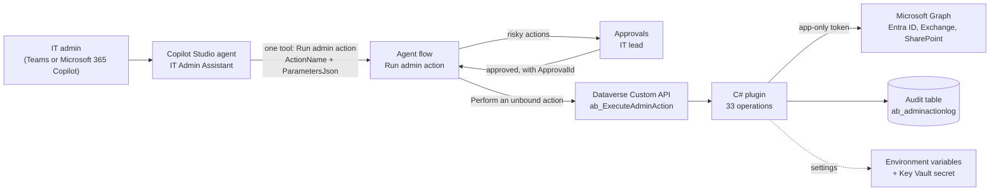

# build-lab-ep01-it-onboarding-agent

**Architect's Build Lab, Episode 1: IT onboarding agent**


An AI agent for IT admins and helpdesk staff. You type "Onboard Priya to Finance, same access as Ankit, manager Rahul" in Teams or Microsoft 365 Copilot, the agent shows you exactly what it will do, and after you confirm it creates the account, sets the manager, copies the groups, assigns licences and emails the temporary password to the manager. Risky things like password resets, role changes and leavers wait for the IT lead's approval.

It runs 33 operations across user onboarding, user management, group management, Entra ID administration and reporting, and every call is written to an audit table.

**Watch the build:** [Architect's Build Lab, Episode 1 on YouTube](<YOUTUBE_VIDEO_LINK>)

I first built this for a large enterprise. This repo is a clean rebuild in a demo tenant, so you can build it too. None of the client's code, names or settings are in here.

## What's inside

| Folder | What it is |
|---|---|
| [`src/OnboardingAgent`](src/OnboardingAgent) | The C# Dataverse plugin behind the `ab_ExecuteAdminAction` Custom API. It calls Microsoft Graph with its own app-only identity. |
| [`flow`](flow) | The "Run admin action" agent flow (Power Automate), as an exported definition plus a plain-English walkthrough. |
| [`agent`](agent) | The Copilot Studio agent "IT Admin Assistant": instructions, the one tool and its description, test prompts. |
| [`docs`](docs) | Setup guide, Graph permissions, the 33 operations, and security notes. |
| [`appsettings.sample.json`](appsettings.sample.json) | Every setting the solution needs, with placeholders only. |

## Architecture



The idea is one agent, one tool, one flow and one plugin. The agent decides *what* to do. The flow handles approvals. The plugin is the only part that touches Entra ID, and it checks every request again on its own, so a confused agent or a tampered flow still can't step outside the fence.

## Prerequisites

- A **demo or developer tenant**. Never build this in a tenant with real people in it.
- Entra ID P1 (for sign-in activity and administrative units). P2 is optional; without it the PIM checks are skipped because eligible assignments can't exist.
- A Power Platform environment with Dataverse, and a Copilot Studio licence or trial.
- An Azure subscription for Key Vault (recommended for the client secret).
- A mailbox to send from (a shared mailbox is fine) and a SharePoint site for Excel reports. Both are optional; the related steps are skipped without them.
- .NET SDK (any recent version) to build. The plugin targets .NET Framework 4.6.2, and the reference assemblies come from NuGet, so you don't need the targeting pack installed.
- The Plugin Registration Tool (`pac tool prt`) or the Power Platform CLI.

## Build

```bash
git clone https://github.com/arihantexplains/build-lab-ep01-it-onboarding-agent.git
cd build-lab-ep01-it-onboarding-agent/src/OnboardingAgent
sn -k OnboardingAgent.snk      # once; the key file is git-ignored, keep it private
dotnet build -c Release
```

The output is a single `OnboardingAgent.dll` with no dependencies beyond .NET Framework and the Dataverse SDK. If the `.snk` file is missing the build still works but the assembly is not signed, and Dataverse will refuse to register it.

## Setup in a demo tenant

The short version is below. The full walkthrough, with every field, is in [docs/setup.md](docs/setup.md).

1. **Demo organisation.** Create test users and groups with a fixed display-name prefix (the demo uses `Demo-`), an administrative unit for the managed staff, and keep your admin accounts outside it.
2. **App registration.** Create one, add a client secret (or certificate), and grant the 15 Graph application permissions in [docs/permissions.md](docs/permissions.md). Grant admin consent. Lock `Mail.Send` to one mailbox and `Sites.Selected` to one site.
3. **Solution and environment variables.** Create a solution with your publisher prefix and the environment variables from [`appsettings.sample.json`](appsettings.sample.json). Put the secret in Key Vault.
4. **Audit table and Custom API.** Create the `ab_adminactionlog` table and the `ab_ExecuteAdminAction` Custom API (unbound action). Field-by-field details are in [src/OnboardingAgent/README.md](src/OnboardingAgent/README.md).
5. **Plugin.** Build, register the assembly, and set the plugin type `OnboardingAgent.ExecuteAdminAction` on the Custom API.
6. **Agent flow.** Recreate "Run admin action" using [flow/README.md](flow/README.md) and the exported definition.
7. **Agent.** Create "IT Admin Assistant" in Copilot Studio, paste the [instructions](agent/instructions.md), add the flow as its only tool with the [tool description](agent/tool-run-admin-action.md).
8. **Test.** Work through [agent/test-prompts.md](agent/test-prompts.md), including the ones that must be refused.

## Security notes

- **Least privilege.** 15 narrow Graph application permissions, and never `Directory.ReadWrite.All`. `AdministrativeUnit.ReadWrite.All` is left out on purpose: with it the app could add anyone to the unit and walk past its own fence.
- **A fence the app can't move.** Every user and group must carry the display-name prefix. Writes also need the user to be in the administrative unit and to hold no admin role. The admin check fails closed.
- **Approvals.** Password resets, role changes, sign-out everywhere, blocking sign-in and offboarding wait for the IT lead. The plugin refuses these without an approval ID, whatever the agent says.
- **No passwords in chat.** Temporary passwords go to the manager by email. They are never returned, logged, traced or saved to Sent Items.
- **Secrets stay out of code.** Every ID and secret comes from environment variables, the secret from Key Vault. This repo has placeholders only.
- **Never use production users.** Test only with made-up people in a demo tenant. Rotate or delete the app credential when you're done.

More in [docs/security.md](docs/security.md). To report a security problem, see [SECURITY.md](SECURITY.md).

## How this was built

Most of the plugin code was written by an AI coding assistant from my spec, and I reviewed every function. Two of its mistakes made it into the video: a build error caused by hidden Unicode characters, and a quiet permission problem that would have let the safety fence approve itself. Both are fixed here.

## Licence

[MIT](LICENSE). Use it, change it, learn from it. It's a teaching sample, so test it properly before you trust it with anything real.

Microsoft, Copilot Studio, Power Automate, Dataverse, Microsoft Entra ID and Microsoft Graph are trademarks of the Microsoft group of companies.
