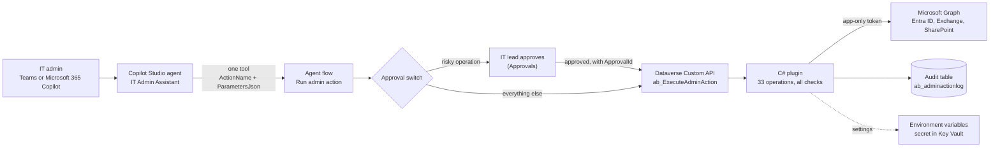

<p align="center">
  
</p>

# build-lab-ep01-it-onboarding-agent

**Architect's Build Lab, Episode 1: an IT onboarding agent in Copilot Studio**

[](LICENSE)
[](https://learn.microsoft.com/power-platform/)
[](https://learn.microsoft.com/microsoft-copilot-studio/)
[](https://learn.microsoft.com/power-apps/maker/data-platform/)
[](https://learn.microsoft.com/graph/)
[](src/OnboardingAgent/OnboardingAgent.csproj)

## What this is and why

Helpdesk teams spend hours on the same user onboarding and user management tasks: new joiners, group changes, password resets, leavers.
This repo is an AI agent that does those tasks from one sentence in Teams, with a preview before every change and the IT lead's approval for the risky ones.
I built it for a large enterprise first; this is a clean rebuild in a demo tenant, so you can build it too.

## Watch the video

<!-- VIDEO: replace the next line with the YouTube link after upload -->
**Coming soon, link added after upload.** Subscribe at [youtube.com/@arihant.explains](https://www.youtube.com/@arihant.explains) to catch it.

## What it achieves

You type:

> Onboard Priya Sharma to Finance as a Financial Analyst. Her manager is Rahul Mehta. Give her the same access as Ankit Verma.

The agent shows you exactly what it will do. When you click Confirm, it:

1. creates the new user in Entra ID with the right name, department and job title,
2. sets her manager,
3. copies Ankit's groups (skipping anything protected or admin-related),
4. assigns her licences,
5. emails the temporary password to her manager, never to the chat,
6. writes every step to an audit table.

The same agent handles user management (look-ups, profile changes, licences, sign-out everywhere, leavers), group management, Entra ID role tasks and quick reports, 33 operations in total. Password resets, role changes and leavers wait for the IT lead's approval.

## Architecture



One agent, one tool, one flow, one plugin. The agent decides *what* to do, the flow decides *whether it needs approval*, and the plugin is the only part that touches Entra ID. The plugin checks every rule again on its own, so a confused agent or an edited flow still can't step outside the fence. The full walkthrough is in [docs/ARCHITECTURE.md](docs/ARCHITECTURE.md).

## The 33 operations

| Area | Operations |
|---|---|
| User onboarding | `OnboardUser`, `CreateUser`, `CloneAccess`, `AssignLicence`, `SendEmail` |
| User management | `GetUser`, `SearchUsers`, `UpdateUser`, `SetManager`, `RemoveManager`, `GetUserLicences`, `RemoveLicence`, `EnableUser`, `ResetPassword`\*, `RevokeSessions`\*, `DisableUser`\*, `OffboardUser`\* |
| Group management | `ListGroups`, `ListGroupMembers`, `GetGroupMemberships`, `AddToGroups`, `RemoveFromGroups` |
| Entra ID administration | `ListAssignableRoles`, `GetUserRoles`, `AssignRole`\*, `RemoveRole`\*, `GetSignInMethods`, `GetSignInStatus` |
| Questions and reports | `GetManagerChain`, `GetDirectReports`, `CountByDepartment`, `AuditQuery`, `BuildExcelReport` |

\* needs the IT lead's approval. What each one does, with its parameters: [docs/operations.md](docs/operations.md).

## Folder map

```text
.
├── src/OnboardingAgent/        C# Dataverse plugin (.NET Framework 4.6.2)
│   ├── ExecuteAdminAction.cs   plugin entry point for the Custom API
│   ├── ActionRouter.cs         operation name -> handler, and the approval list
│   ├── Validator.cs            the fence: prefix, administrative unit, no admins
│   ├── GraphClient.cs          app-only token, retries, paging, time budget
│   ├── Functions/              one class per operation (33)
│   └── Functions/Parameters/   one parser per operation's JSON parameters
├── flow/                       the "Run admin action" agent flow (definition + walkthrough)
├── agent/                      Copilot Studio agent: instructions, tool, test prompts
├── docs/                       architecture, setup, permissions, operations, security
├── appsettings.sample.json     every setting, placeholders only
├── SECURITY.md  CONTRIBUTING.md  CHANGELOG.md  LICENSE
└── .github/ISSUE_TEMPLATE/     bug report and setup question forms
```

## Prerequisites

- A **demo or developer tenant**. Never build this in a tenant with real people in it.
- Entra ID P1 (administrative units and sign-in activity). P2 is optional; without it the PIM checks are skipped.
- A Power Platform environment with Dataverse, and Copilot Studio (a trial is fine).
- An Azure subscription for Key Vault, to hold the client secret.
- Optional: a mailbox to send from and a SharePoint site for Excel reports. Without them those steps are skipped.
- .NET SDK (any recent version). The .NET Framework reference assemblies come from NuGet, so no targeting pack is needed.
- The Power Platform CLI (`pac`) for the Plugin Registration Tool.

## Setup in a demo tenant

Build bottom-up and test each layer before the next. Every step is spelled out in [docs/setup.md](docs/setup.md).

1. **Fake organisation.** Demo users and groups with a fixed display-name prefix (`Demo-`), an administrative unit for normal staff, admin users kept outside it.
2. **App registration.** Client secret in Key Vault, the 15 Graph application permissions below, admin consent, User Administrator scoped to the administrative unit.
3. **Solution and environment variables.** Copy the names from [`appsettings.sample.json`](appsettings.sample.json) and fill in your own values.
4. **Audit table and Custom API.** `ab_adminactionlog` and `ab_ExecuteAdminAction`, field by field in [src/OnboardingAgent/README.md](src/OnboardingAgent/README.md).
5. **Build and register the plugin.**

   ```bash
   git clone https://github.com/arihantexplains/build-lab-ep01-it-onboarding-agent.git
   cd build-lab-ep01-it-onboarding-agent/src/OnboardingAgent
   sn -k OnboardingAgent.snk      # once; git-ignored, keep it private
   dotnet build -c Release
   ```

   Register `bin/Release/net462/OnboardingAgent.dll` and set the plugin type `OnboardingAgent.ExecuteAdminAction` on the Custom API.
6. **Agent flow.** Recreate "Run admin action" from [flow/README.md](flow/README.md).
7. **Agent.** Create "IT Admin Assistant" with the [instructions](agent/instructions.md) and the flow as its only [tool](agent/tool-run-admin-action.md).
8. **Test.** Run [agent/test-prompts.md](agent/test-prompts.md), including the prompts that must be refused.

## Graph permissions (least privilege)

15 application permissions, each the narrowest one Microsoft Learn lists for the call:

`User.Create`, `User.ReadUpdate.All`, `User.ReadWrite.All` (manager only), `User.Read.All`, `Directory.Read.All`, `User-PasswordProfile.ReadWrite.All`, `User.EnableDisableAccount.All`, `User.RevokeSessions.All`, `GroupMember.ReadWrite.All`, `RoleManagement.ReadWrite.Directory`, `LicenseAssignment.ReadWrite.All`, `UserAuthenticationMethod.Read.All`, `AuditLog.Read.All`, `Mail.Send` (locked to one mailbox), `Sites.Selected` (one site).

Left out on purpose: `Directory.ReadWrite.All`, and `AdministrativeUnit.ReadWrite.All`, because with it the app could add anyone to the unit and walk past its own fence. Why each permission is needed: [docs/permissions.md](docs/permissions.md).

## Security model

| Layer | Guardrail |
|---|---|
| Who can chat | Agent shared with one IT security group, Entra ID sign-in |
| Who can call the plugin | Custom API protected by an Execute Privilege, held only by IT staff |
| Scope | Only users and groups with the `Demo-` prefix; changes only inside the administrative unit |
| Admins | Anyone holding a directory role is off limits; the check fails closed |
| Risky operations | The plugin refuses them without an approval ID; the flow only passes one after the IT lead approves (see the known limit in [docs/security.md](docs/security.md#approvals)) |
| Roles | Only roles on the allow-list, scoped to the administrative unit |
| Passwords | Emailed to the manager only; never returned, logged or shown in chat |
| Secrets | Environment variables and Key Vault; nothing in code or Git |
| Audit | One row per call: who, what, target, approval, result |

Details in [docs/security.md](docs/security.md). To report a problem, see [SECURITY.md](SECURITY.md).

## Troubleshooting

| You see | Likely cause and fix |
|---|---|
| "Microsoft Graph did not accept the app's credentials" | Wrong tenant ID, client ID or secret in the environment variables, or the secret expired. |
| "Access denied by Microsoft Graph" | A permission is missing or admin consent wasn't granted. For password resets, the app also needs User Administrator on the administrative unit. |
| "Environment variable ... has no value" | Create the variable in the solution and give it a current value in this environment. |
| "Could not read the secret environment variable" | Dataverse can't reach Key Vault. Check the vault's access setup for secret environment variables on Microsoft Learn. |
| "... needs an ApprovalId" | A risky operation was called without going through the flow's approval branch. That refusal is by design. |
| The user is created but "add to administrative unit" failed | Expected: the app has no `AdministrativeUnit.ReadWrite.All`. An administrator adds the user to the unit. |
| "Microsoft Graph is throttling requests" | Wait a few minutes. The plugin already retries within its 90-second budget. |
| Plugin registration fails with a strong-name error | Run `sn -k OnboardingAgent.snk` and rebuild, so the assembly is signed. |
| The agent picks the wrong operation | Check the tool description and the flow's `ActionName` description; the orchestrator reads both. |

## FAQ

**Why one tool instead of one flow per task?** I started with six flows. One well-described tool with a clear operation list made the agent choose more reliably, and there is only one place to secure.

**Why a C# plugin and not Graph calls inside the flow?** The plugin keeps all the rules in one tested place, runs with its own app identity, and can't be bypassed by editing the flow.

**Can I use this in production?** It is a teaching sample. The patterns are the ones I use in real projects, but test it properly and have it reviewed before you trust it with real users.

**Does it need Microsoft 365 Copilot licences?** No. It runs in Teams through Copilot Studio. Microsoft 365 Copilot is just another channel.

**Can I use a certificate instead of a client secret?** Yes, and outside a demo you should. You would change how `GraphClient.cs` gets its token.

**Why is the AI-written code in a public repo?** Because that's the point of the series. An AI assistant wrote most of the plugin from my spec, I reviewed every function, and the video shows the two mistakes I caught.

## Credits

Built and explained by **Arihant Jain** ([Arihant Explains](https://www.youtube.com/@arihant.explains)), a Solution Architect with nearly 15 years of experience building business apps, automation and AI solutions on Power Platform, Copilot Studio, Dataverse and Azure.

Contributions are welcome, see [CONTRIBUTING.md](CONTRIBUTING.md). Changes are listed in [CHANGELOG.md](CHANGELOG.md).

## License

[MIT](LICENSE). Use it, change it, learn from it.

Microsoft, Copilot Studio, Power Automate, Dataverse, Microsoft Entra ID and Microsoft Graph are trademarks of the Microsoft group of companies.
