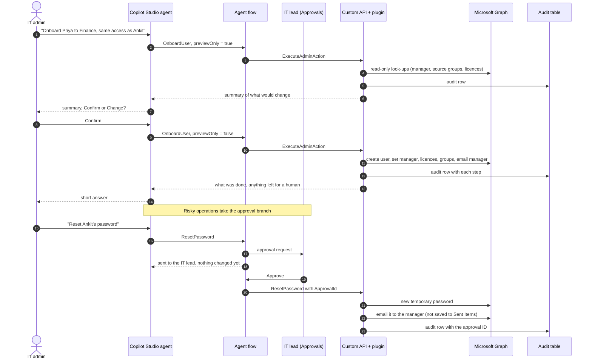
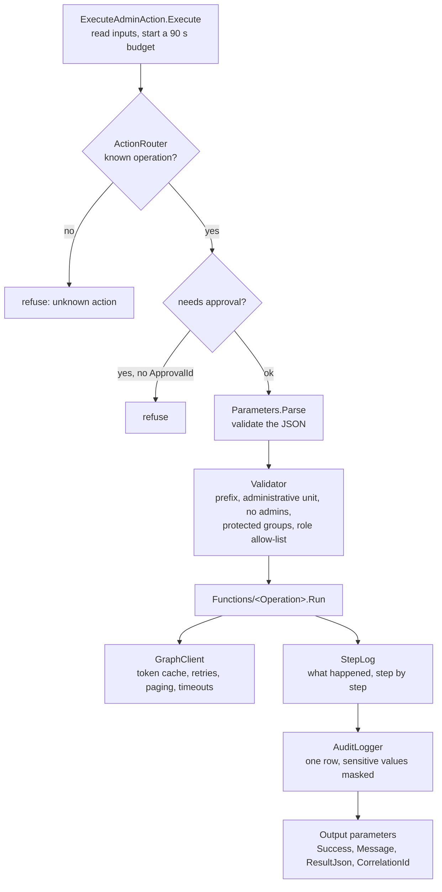

# Architecture deep dive

This page follows one request from the chat window to Entra ID and back, then explains the design choices.

## The four pieces

| Piece | Lives in | Job | Knows about Graph? |
|---|---|---|---|
| Copilot Studio agent "IT Admin Assistant" | Copilot Studio | Understands the request, picks one operation, fills its parameters, asks Confirm or Change | No |
| Agent flow "Run admin action" | Power Automate, in the solution | Routes risky operations through an approval, calls the Custom API, returns the answer | No |
| Custom API `ab_ExecuteAdminAction` | Dataverse | A typed, secured entry point with an Execute Privilege | No |
| Plugin `OnboardingAgent.dll` | Dataverse sandbox | Validates everything, calls Microsoft Graph as its own app identity, writes the audit row | Yes, only this |

## One request, end to end

## Inside the plugin

Key files:

- `ExecuteAdminAction.cs`: the plugin entry point. It never throws. Every outcome, including a failure, goes back through the output parameters, so the audit row is never rolled back.
- `ActionRouter.cs`: the map from operation name to handler, and the list of operations that need approval.
- `Validator.cs`: the fence. Every operation goes through it before any write.
- `DirectoryService.cs`: resolves the names typed in chat ("Ankit Verma") to exactly one user, and reads managers, groups and mailboxes.
- `GraphClient.cs`: client-credentials token, a per-request timeout of at most 25 seconds, retries on throttling, and paging that stops before the time budget runs out.
- `Config.cs`: reads the environment variables (and the Key Vault secret) and caches them for five minutes.
- `Json*.cs`: a small JSON reader and writer, so the assembly has no dependencies beyond the Dataverse SDK.
- `XlsxBuilder.cs`: writes a minimal `.xlsx` for `BuildExcelReport` without extra libraries.

## Design choices

**One tool, not six.** The first version had a flow per task family. The orchestrator sometimes picked the wrong flow and every flow needed its own security review. One tool with a grouped operation list in its description was easier for the agent and for me.

**The plugin is the only thing that touches Graph.** Flows are easy to edit and easy to get wrong. Keeping Graph calls in compiled, reviewed code means the rules live in one place and the flow can't widen them.

**Every rule is checked twice.** The agent's instructions say "never act on administrators", and the plugin refuses anyway. The agent is the friendly front door; the plugin is the lock.

**Preview first.** `OnboardUser` and `CloneAccess` default to `previewOnly: true`. The agent shows the preview and only runs it for real after Confirm.

**Approvals answer immediately.** The flow replies "sent to the IT lead" as soon as the approval is created, then waits. The chat isn't blocked for hours.

**No admin rights over the fence itself.** The app can't change administrative unit membership. If it could, a bug or a clever prompt could move someone into scope and then act on them.

**Names in, names out.** The agent passes names as the user typed them; the plugin resolves them and refuses if the match isn't unique. Results go back with display names, so the agent never needs IDs or sign-in names.

**Time-boxed.** Dataverse gives a plugin two minutes. The plugin gives itself 90 seconds and stops retries and paging early, so it always returns a clean answer instead of timing out.

## Data stored

| Where | What | Not stored |
|---|---|---|
| `ab_adminactionlog` | operation, requester, target, approval ID, correlation ID, result message, duration, parameters with sensitive values masked | passwords, tokens, secrets |
| Flow run history | inputs and outputs, with secure inputs and outputs on the approved steps | passwords |
| Entra ID audit log | the directory changes themselves, made by the app | |
