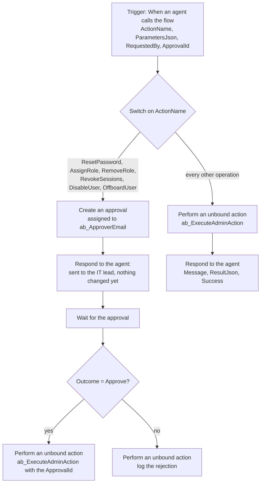

# Agent flow: Run admin action

One agent flow sits between the Copilot Studio agent and the plugin. It does three jobs:

1. Takes `ActionName` and `ParametersJson` from the agent.
2. For the six risky operations, asks the IT lead for approval and only runs the operation once it is approved.
3. Calls the `ab_ExecuteAdminAction` Custom API and sends the plugin's answer back to the agent.

[`run-admin-action.definition.json`](run-admin-action.definition.json) is the exported flow definition (the `properties` part of the flow in a solution). It has no environment-specific values: the approver comes from the `ab_ApproverEmail` environment variable and the connections are connection references. You can import it as part of your own solution, or use it as a reference while you build the flow by hand with the steps below.

## Build it step by step

Create the flow inside your solution: **New > Automation > Cloud flow > Instant**, trigger **When an agent calls the flow** (in Copilot Studio this is "Agent flow").

### 1. Trigger inputs

| Input | Type | Required | Description (the agent reads this) |
|---|---|---|---|
| `ActionName` | Text | Yes | Which admin action to run, exactly one of the 33 names. The full text with the grouped list is in the definition file. |
| `ParametersJson` | Text | Yes | The parameters as one JSON object, using people and groups by the name the user gave. The description lists the parameters per operation with examples. |
| `RequestedBy` | Text | No | Optional name of the person asking. The flow prefers the signed-in user's email from the request header. |
| `ApprovalId` | Text | No | Leave empty. A value here never skips an approval. |

Copy the descriptions from the definition file. They matter more than anything else in the flow, because they are how the agent learns to fill the inputs.

### 2. Switch on ActionName

Add a **Switch** on `trim(triggerBody()?['ActionName'])` with one case per risky operation: `ResetPassword`, `AssignRole`, `RemoveRole`, `RevokeSessions`, `DisableUser`, `OffboardUser`.

### 3. Each risky case

1. **Create an approval** (Approvals connector, type "Approve/Reject - First to respond"):
   - Assigned to: the `ab_ApproverEmail` environment variable.
   - Title: for example "Reset password: approval needed".
   - Details: the action, the parameters and who asked. Say plainly that nothing changes unless they approve.
2. **Respond to the agent** straight away: `Success = true`, message "Sent to the IT lead for approval. Nothing has changed yet." The agent can reply to the user now instead of waiting hours.
3. **Wait for an approval** using the approval ID from step 1.
4. **Condition**: outcome equals `Approve`.
   - Yes: **Perform an unbound action** `ab_ExecuteAdminAction` with `ActionName`, `ParametersJson`, `RequestedBy` and `ApprovalId` set to the approval's ID. The plugin refuses risky operations without it.
   - No: **Add a new row** to the `ab_adminactionlog` table with `ab_success = false` and the message "The IT lead rejected this request. Nothing was changed."
5. Add a second response that runs only if creating the approval fails, so the agent always gets an answer.

### 4. Default case

1. **Perform an unbound action** `ab_ExecuteAdminAction` with `ActionName`, `ParametersJson` and `RequestedBy` = `coalesce(triggerOutputs()?['headers']?['x-ms-user-email'], triggerBody()?['RequestedBy'], 'IT Admin Assistant agent')`.
2. **Respond to the agent** (run after: succeeded) with `Message`, `ResultJson` and `Success` from the action's output.
3. **Respond to the agent** (run after: failed or timed out) with a clean error message, so the agent never hangs.

### 5. Settings worth turning on

- **Secure inputs and outputs** on any step that could ever carry a password. The plugin never returns one, but this keeps run history clean if someone changes the code later.
- Connection references for Dataverse and Approvals, so the solution moves between environments without edits.

## Test it before the agent exists

Run the flow on its own with `ActionName = CountByDepartment` and `ParametersJson = {}`. Then try `ResetPassword` for a demo user, approve once and reject once, and check both rows in the audit table.
